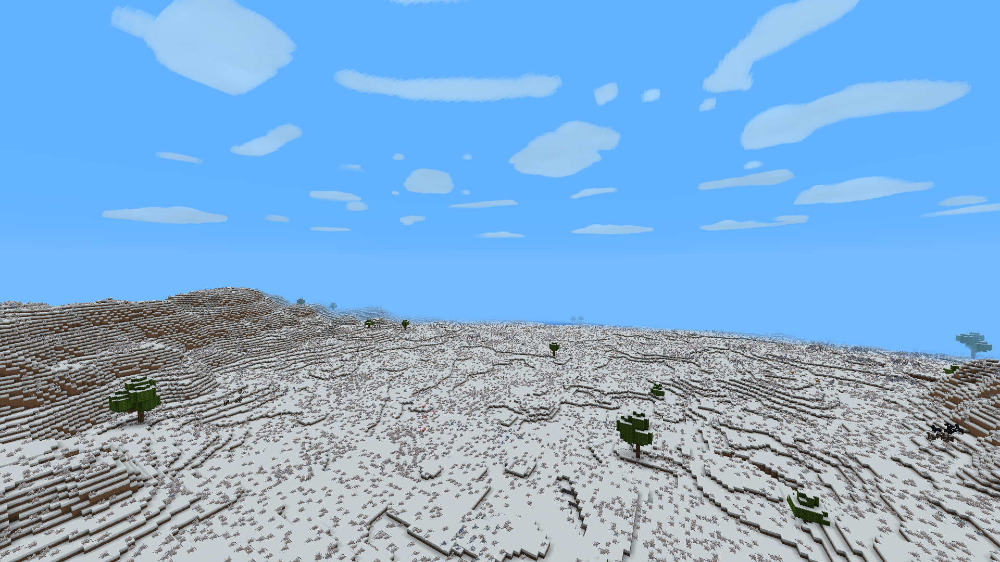
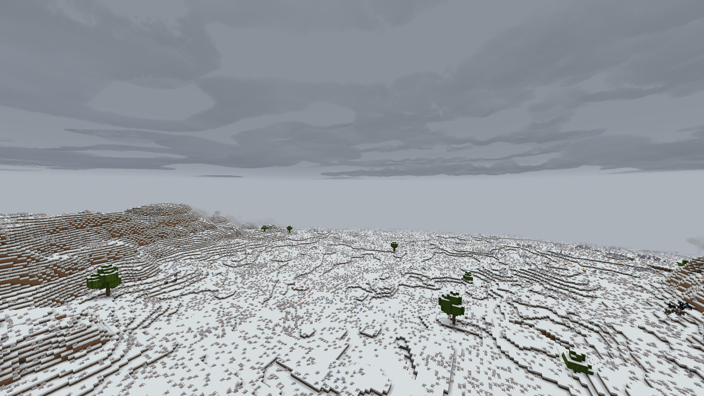
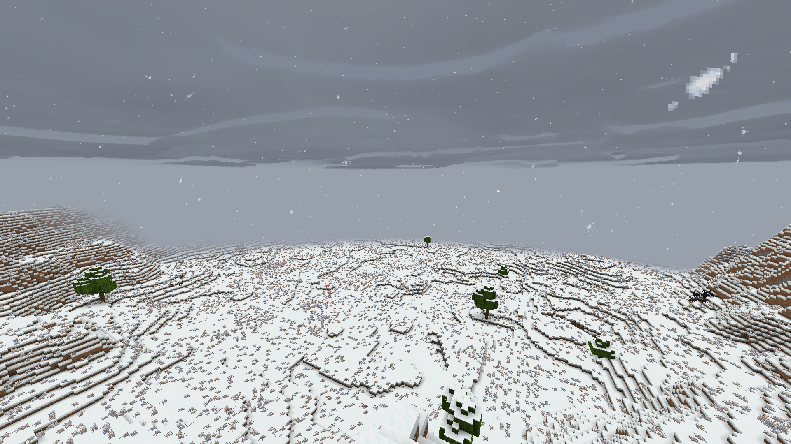
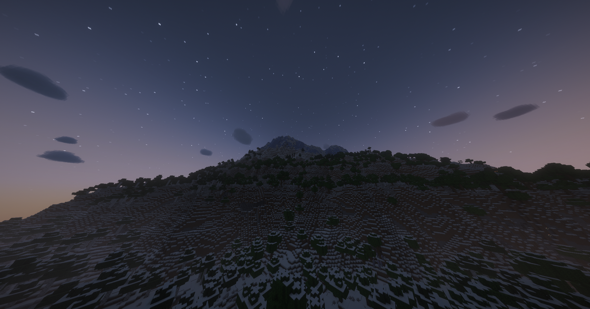
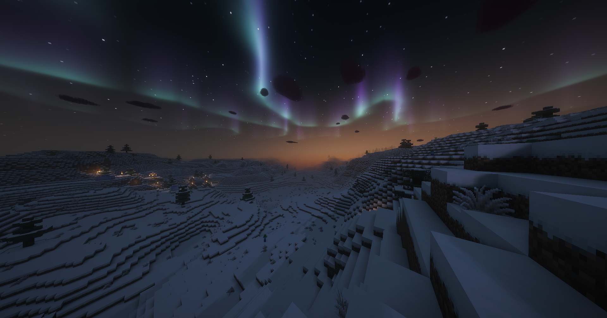
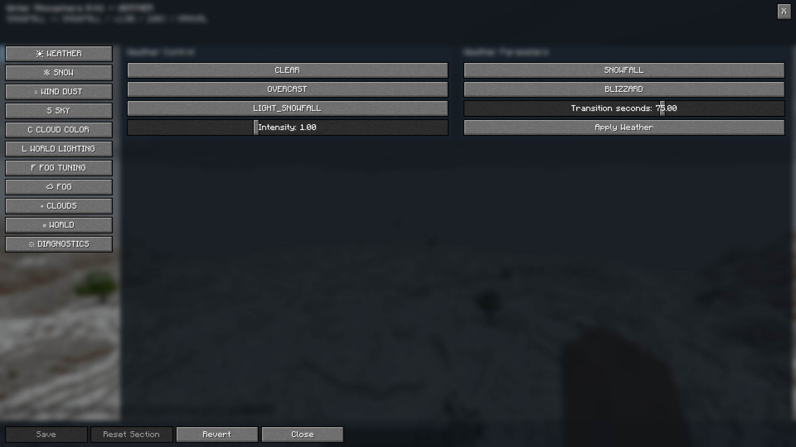
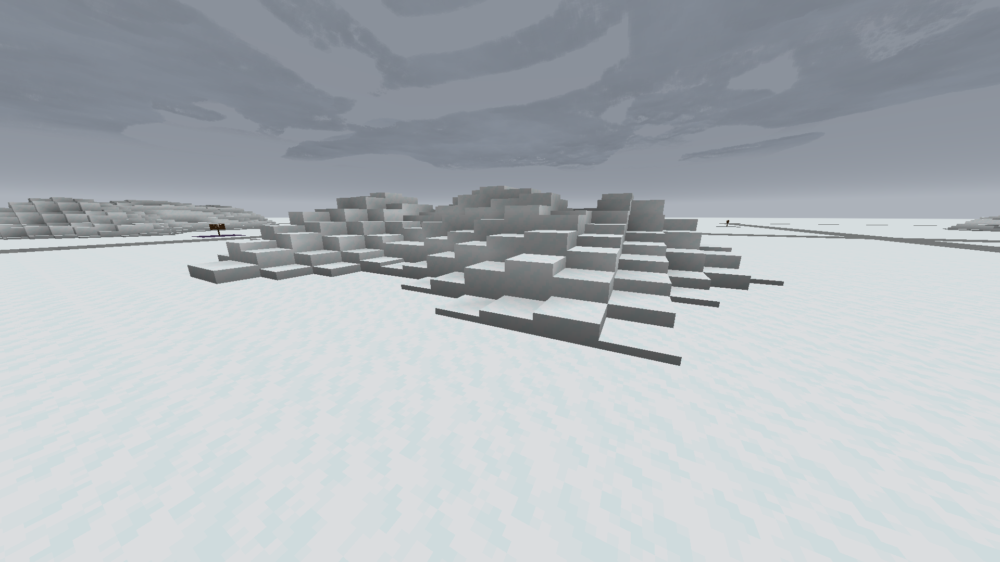

# ❄️ Winter Atmosphere

### Minecraft Fabric 1.21.1 | Java 21 | Gradle

Winter Atmosphere is an independently developed Minecraft mod focused on dynamic winter weather, natural snow accumulation, and immersive atmospheric effects.

## ✨ Features & Development

- Dynamic winter weather across five states: CLEAR, OVERCAST, LIGHT_SNOWFALL, SNOWFALL, and BLIZZARD
- Custom snowfall particles and configurable visual effects
- Terrain-aware natural snowdrifts with gradual placement
- Experimental cloud, sky, fog, and lighting systems
- Development tools for debugging weather mechanics

Some features are still experimental and undergoing in-game validation.

## 🛠️ Technologies

- Java 21
- Minecraft Fabric 1.21.1
- Gradle / Fabric Loom
- Git & GitHub
- Automated testing

## 🧪 Testing

253 Java unit tests passed in the latest verified Winter Atmosphere build. Minecraft GameTests and visual behavior require separate in-game validation.

## 📸 Screenshots & Demonstrations

### Dynamic Winter Weather

Three real in-game screenshots captured from the same viewpoint show clear skies, overcast conditions, and active snowfall.

| Clear | Overcast | Snowfall |
|:---:|:---:|:---:|
|  |  |  |

### Dynamic Cloud System & Winter Landscapes

The experimental CLEAR cloud field combines five size categories—small, medium, large, dominant, and GIANT—with natural clustering and adaptive cloud population. Rare GIANT clouds add larger silhouettes to the open winter sky. Cloud rendering and shader compatibility remain under development.

### Developer Panel (F8)

An in-game developer interface for selecting weather states, adjusting snowfall intensity, and testing transition duration.

### Natural Snowdrifts | Test Arena

Three real in-game screenshots captured in the Winter Atmosphere development test arena, showing different layered snowdrift shapes and profiles.

**Technical notes:** The Natural Snowdrifts v4 implementation uses deterministic shape variation and incremental block placement with a dedicated per-tick budget. Large snowdrifts target a base radius of 14 blocks, with a randomized range of 12–16 blocks.

*These images show test-arena results, not proof of natural-world spawning or performance under load. The three screenshots are not labeled as SMALL, MEDIUM, or LARGE because their exact spawn types have not been verified.*

Additional weather and developer-panel demonstrations are being prepared.

## 👨‍💻 About the Developer

I'm a Java developer focused on Minecraft modding, gameplay systems, debugging, and performance-conscious development.

Open to small paid Java and Minecraft development commissions.

## 📬 Contact

BuiltByBit: Diolent
Discord: Diolent

---

*This is a public showcase. The full source code is maintained privately.*
